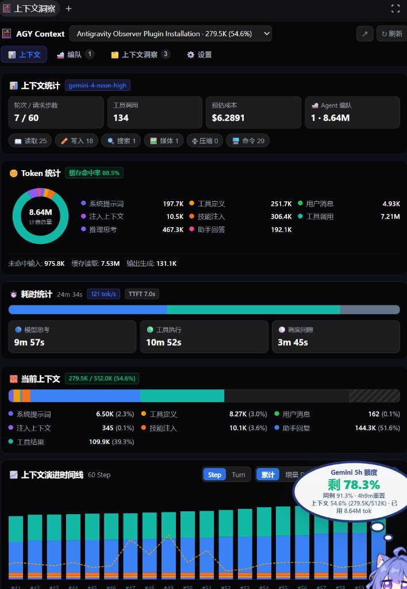
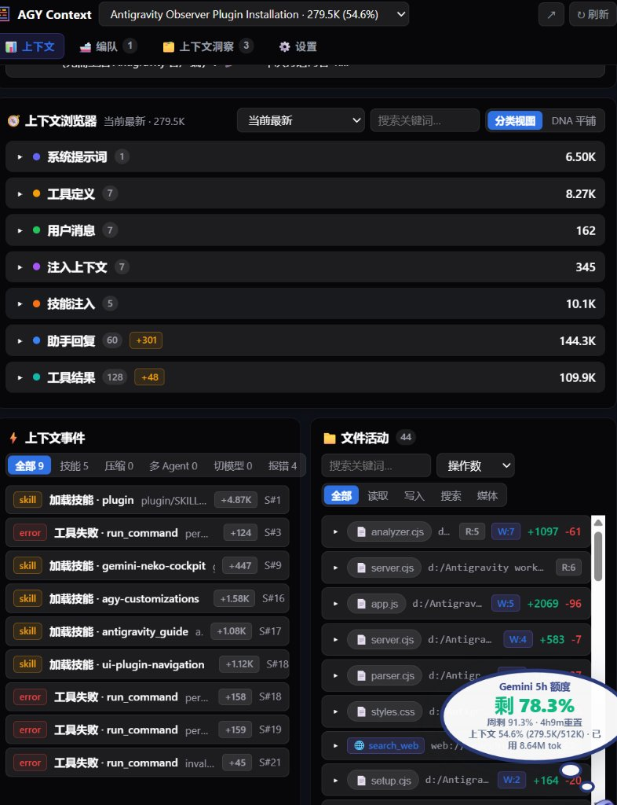
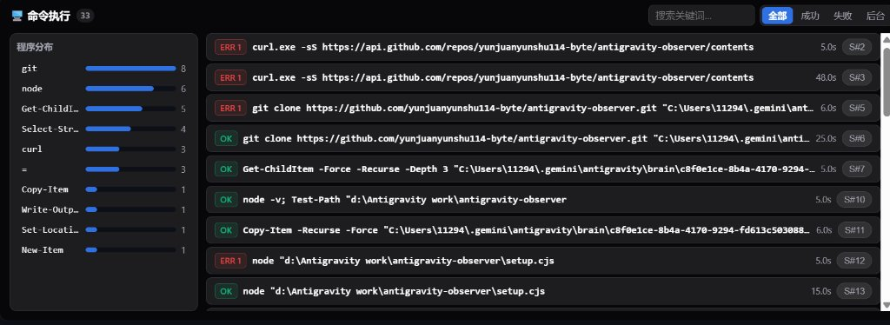
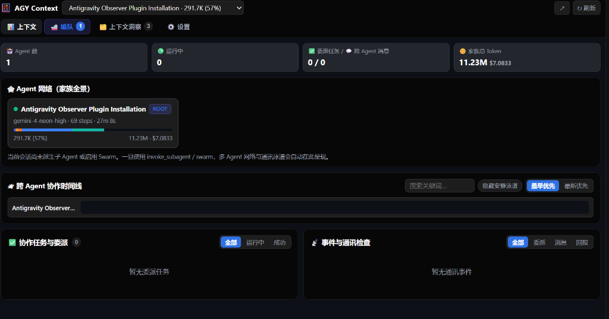
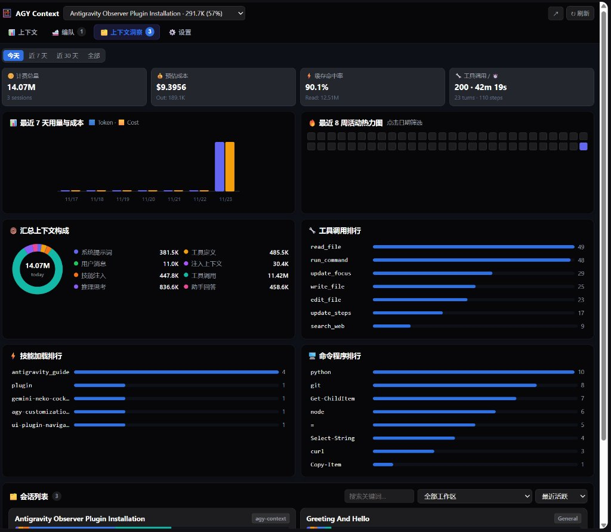
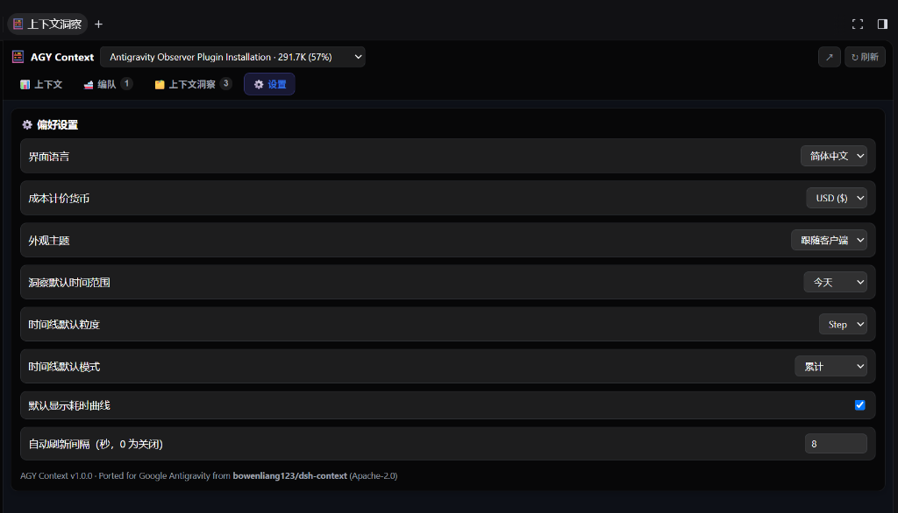

# AGY Context · 反重力上下文洞察（`dsh-context` 移植版 v1.1.0）

> 将 DeepSeek Harness 官方推荐的上下文洞察插件 [`bowenliang123/dsh-context`](https://github.com/bowenliang123/dsh-context)（同步至 `v0.87.2+`）完整移植到 **Google Antigravity** 的原生插件（Plugin + Sidecar 侧栏面板 + Skill + 可选 DSH 会话顶栏标签补丁），零外部运行时依赖，开箱即用。

---

## 📸 实机运行截图

<table>
  <tr>
    <td width="50%" align="center">
      <br />
      <sub><b>上下文仪表板</b>：统计三联卡、当前上下文 512K 堆叠条与 Step 演进时间线</sub>
    </td>
    <td width="50%" align="center">
      <br />
      <sub><b>上下文浏览器 & 事件与文件活动</b>：7 类折叠展开、技能/报错事件与文件改动统计</sub>
    </td>
  </tr>
  <tr>
    <td width="50%" align="center">
      <br />
      <sub><b>命令执行</b>：程序调用分布柱状图、状态筛选与执行耗时明细</sub>
    </td>
    <td width="50%" align="center">
      <br />
      <sub><b>多 Agent 编队（Fleet）</b>：家族关系网络、跨 Agent 泳道与委派/通讯检查</sub>
    </td>
  </tr>
  <tr>
    <td width="50%" align="center">
      <br />
      <sub><b>跨会话洞察（Insights）</b>：KPI、7 天双柱图、8 周热力图、汇总环形图与工具/技能排行</sub>
    </td>
    <td width="50%" align="center">
      <br />
      <sub><b>偏好设置（Settings）</b>：中英双语、USD/CNY 计价、主题与自动刷新配置</sub>
    </td>
  </tr>
</table>

---

## ✨ 核心功能（四大视图）

### 1. 📊 上下文仪表板（Context）
- **三联指标卡**：
  - **上下文统计（Context Stats）**：轮次/步数、工具调用数、预估成本（USD/CNY）、Agent 编队快捷跳转，以及文件读取/写入/搜索/媒体/压缩/命令跳转胶囊；
  - **Token 统计（Token Stats）**：8 分类计费环形图（系统提示词、工具定义、用户消息、注入上下文、技能注入、工具调用、推理思考、助手回答）与精确缓存命中率；
  - **耗时统计（Timing Stats）**：模型思考、工具执行与调度间隙分布条。
- **🧱 当前上下文（Current Context）**：7 色堆叠条按模型完整上下文窗口比例呈现，末尾带斜线预留输出窗口，点击色块直达浏览器对应分类。
- **📈 上下文演进时间线（Context Timeline）**：
  - 支持 **Step / Turn** 粒度切换；
  - 支持 **累计（Total）**、**增量（Delta，压缩回收向下延伸）** 与 **总览带（Overview）** 三种阅读模式 + **耗时曲线**叠加；
  - **事件旗标**：自动标注压缩、技能加载、子 Agent 派生、模型切换、异常报错、最大增长步与最慢步；
  - **✨ 步骤摘要（Step Brief）**：展示实际 `Actual Prompt / Cache / Output / Cost` 与 `User / In / Response` 三行通俗摘要，点击柱状图即可固定并联动上下文浏览器。
- **🧭 上下文浏览器（Context Browser）**：
  - **7 大折叠分类**（系统提示词、工具定义[带来源芯片]、用户消息、注入上下文、技能注入、助手回复[支持 Thinking / Tools / Answer 筛选]、工具结果[OK/ERR + 完整参数与正文]），带 `vs 上一轮` 差异徽标；
  - **DNA 平铺模式**：按模型读取顺序绘制色带，下方倒排平铺完整请求内容并标明 `#位置` 与引入步骤。
- **⚡ 上下文事件 / 📁 文件活动 / 🖥️ 命令执行**：
  - 事件按类型筛选并联动跳转时间线；
  - 文件活动统计读/写/搜/媒体与 `+新增 / -删除` 行数估算，点击文件名可直接在内置抽屉预览文件内容；
  - 命令执行按程序频率分布 + 状态筛选 + 展开完整输出。

### 2. 🚢 多 Agent 编队（Fleet）
同时兼容 Antigravity 的 **`invoke_subagent` / `send_message`** 与原生 **Swarm**（`.system_generated/swarm/members.json` + `board.jsonl`）：
- **🕸 Agent 网络（家族全景）**：递归发现主会话与所有子/孙 Agent，实时显示状态脉冲、上下文占比微条、步数与 Token 消耗；点击节点即可收窄整页视角。
- **🛰 跨 Agent 协作时间线**：每个 Agent 独立泳道，统一时间轴展示委派、消息与回报节点，支持隐藏安静泳道与正/倒序切换。
- **✅ 协作任务与委派**：集中展示每个子 Agent 的 Role、TypeName、Workspace、完整 Prompt 简报与最终回报。
- **📡 事件与通讯检查器**：完整还原每一条跨 Agent 消息的来源会话、步骤号与原文内容。

### 3. 🗂️ 跨会话上下文洞察（Insights）
- **KPI 栏**：支持今天 / 近 7 天 / 近 30 天 / 全部时间范围；
- **7 天用量与成本双柱状图**（按每条请求真实发生日归因）；
- **8 周活动热力图**（点击任意日期即可筛选当天活跃会话）；
- **汇总组成环形图** + **技能加载 / 工具调用 / 命令程序** 高频排行（点击联动筛选会话）；
- **会话卡片列表**：按工作区筛选、搜索、按最近活跃/Token/上下文/成本排序，一键切换到该会话分析。

### 4. ⚙️ 偏好设置（Settings）
支持中英双语切换、USD/CNY 计价切换、暗/亮主题自动跟随客户端、默认时间范围、默认时间线粒度/模式与自动刷新间隔，持久化保存在 Sidecar 数据目录中。

---

## 📦 安装与使用

### 前置要求
- **Google Antigravity 2.0+**
- **Node.js 18+**（零 npm 第三方依赖，无需 `npm install`）

### 安装方式
先克隆仓库（或点击 GitHub 页面右上角 **Code → Download ZIP** 解压）：
```bash
git clone https://github.com/1129408341/agy-context.git
cd agy-context
```

#### 方式 1：纯原生侧栏模式（零改动客户端，更新不失效）
- **Windows 一键安装**：双击运行 `双击安装反重力上下文洞察.bat`
- **命令行安装**（Windows / macOS / Linux 通用）：
  ```bash
  node setup.cjs
  ```

#### 方式 2：复刻 DSH 会话顶栏标签（推荐效率党 · 可选补丁）
在会话标题正下方直接增加 **`对话` · `上下文（含实时占用%）` · `编队（含成员数）` · `洞察`** 快捷切换栏，一键秒切、按 `Esc` 秒回对话；通过独立标记块 `AGY_CONTEXT_HEADER_BEGIN..END` 无损注入，**自动保留 `AG_ZH` 中文汉化与猫娘挂件（`GEMINI_NEKO_HUD`）补丁，互不冲突**：
- **Windows 一键安装**：双击运行 `双击安装会话顶栏标签补丁.bat`
- **命令行安装**：
  ```bash
  node setup.cjs --patch-header --kill --relaunch
  ```
- **仅移除顶栏补丁**（保留原生侧栏插件与汉化/猫娘）：双击 `双击移除会话顶栏标签补丁.bat` 或运行 `node setup.cjs --unpatch-header --kill --relaunch`

### 打开方式
1. 在 Antigravity 对话中发送「**打开上下文洞察**」或调用 `/agy-context`，点击回复中的侧栏胶囊 `[上下文洞察](sidecar://agy-context/context-insight/ui.html)`；
2. 在插件管理页 `[AGY Context](customization://agy-context)` 中查看或开关插件；
3. 如需在独立浏览器大屏查看，可在仓库目录运行：
   ```bash
   node setup.cjs --serve
   ```
   然后访问 `http://127.0.0.1:8095/ui.html`。

### 校验与卸载
```bash
# 检查安装状态与本地会话检测
node setup.cjs --check

# 卸载插件
node setup.cjs --uninstall
```

---

## 🙏 致谢与许可证
本项目基于 Apache-2.0 协议，功能理念、视觉色彩体系与交互架构移植自开源项目 [`bowenliang123/dsh-context`](https://github.com/bowenliang123/dsh-context)，特此致谢原作者。
